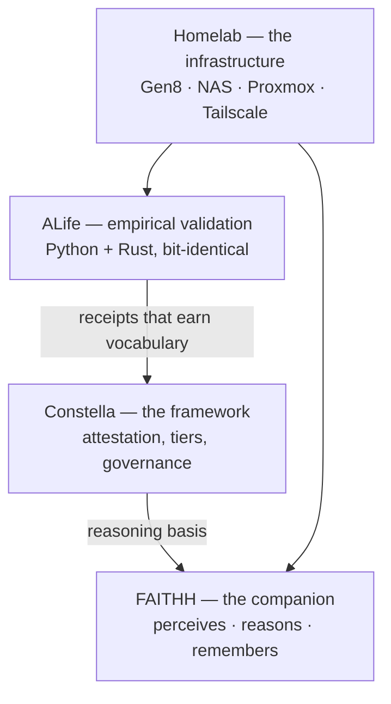

# Jonathan Morales — Nightmarejam

I build systems where claims have to survive independent verification — an AI companion,
a governance framework, and the homelab they run on. Audio engineer building verifiable AI
systems from a homelab. Everything here is **human-directed, AI-assisted**, openly, with receipts.

## What exists today

- **A reproducible ALife engine in two languages.** The Rust port reproduces the Python
  reference **bit-for-bit** — not "similar results," identical state hashes. Verification
  anchors are published in the source and re-checked after every engine change, so the claim
  is falsifiable by anyone who clones it.
- **~16 governance behaviors confirmed with boundaries** — and the falsified ones kept in the
  record rather than deleted.
- **A personal AI companion** (FAITHH) with persistent memory over **~450k indexed documents**
  across four live collections.
- **The homelab it runs on**: ~20 containers on an HP ProLiant Gen8, Tailscale-addressed, so
  nothing breaks when IPs move.
- **Docs under CI**: a link/coherence audit runs on the framework repo in GitHub Actions.

**Technical areas:** local AI systems · reproducible simulation · knowledge systems ·
homelab infrastructure · governance research
**Implementation:** Python · Rust · C#/.NET · Docker · Proxmox · ChromaDB · local LLM infrastructure

## The one idea

**Attestation**: never treat something as true, or act on it, without a checkable receipt.
FAITHH uses it to stay honest about what it knows; Constella proposes it for how a community
decides things; the ALife sandbox is where a claim earns the right to become vocabulary.
The same discipline applied at three different scales.

If you read one file: [the confirmability schema](https://github.com/Nightmarejam/constella-framework/blob/main/docs/reference/confirmability.md).



## The ecosystem

**Empirical validation**
- [alife](https://github.com/Nightmarejam/alife) — a bit-exact artificial-life ecology that
  *tests* Constella's mechanisms (civic floor, diversity reserves) at scale. Two independent
  implementations, Python and Rust, that must agree hash-for-hash before a result counts.
  Findings **including honest negatives** are the receipts behind the framework's claims.
  `alife-core help` lists every falsifiable mode in the catalog.

**The framework**
- [constella-framework](https://github.com/Nightmarejam/constella-framework) — a civic
  governance framework built on attestation; also the logic basis FAITHH runs on.
- [celestial-equilibrium](https://github.com/Nightmarejam/celestial-equilibrium) — a doctrine
  text (CC BY 4.0) that Constella builds on.

**The companion**
- [faithh-pet-terminal](https://github.com/Nightmarejam/faithh-pet-terminal) — **FAITHH**, a
  personal AI companion (Mega Man Battle Network–inspired NetNavi) that perceives, reasons,
  remembers, and is learning to act — honestly.

**The infrastructure**
- [SensorBridge](https://github.com/Nightmarejam/SensorBridge) — host→VM hardware telemetry
  in C#; the node-health layer feeding the companion.
- [runbook-to-rule-them-all](https://github.com/Nightmarejam/runbook-to-rule-them-all) — the
  ops runbooks that keep the homelab running.

*Private:* homelab (hardware + the conversation-to-knowledge pipeline), research-notes
(cross-domain theory), tomcat-sound (business records).

## How the work is made — and how to check it

- **Confirmability tiers.** Docs claim facts as `confirmed` (with a receipt: git commit, live
  check, benchmark) / `asserted` / `speculative`. Nothing is promoted without the receipt.
- **Failures stay in the record.** Results — including falsified hypotheses — are preserved and
  documented rather than quietly rewritten. The commit log doubles as the lab notebook:

  ```
  v6: accountability cap (reproduction-throttle) FALSIFIED across 4 variants
  Honest negative: transitional-scaffolding did NOT reproduce in b2
  B4 CONFIRMED: founding-diversity is load-bearing (Rust reproduces Exp 8b)
  ```

- **Cross-language validation.** A second implementation exists so the first one can't lie to
  me. Determinism probes gate every engine change.
- **AI attribution is in the history.** AI-assisted commits carry `Co-Authored-By` trailers
  naming the model — the git log is the honest record of who did what.
- **Sourced docs.** A documented pipeline turns archived design conversations into tiered docs;
  every extracted doc cites its source threads by title and date. Continuity is tracked in
  [concept_lineage.md](https://github.com/Nightmarejam/constella-framework/blob/main/docs/reference/concept_lineage.md), not vibes.

## Scope — what these are, and are not

**Research status:** personal research-and-build repos, actively in development — not companies,
not shipping products, not services you can sign up for.

- **FAITHH** runs on my own homelab. Not a hosted product, not deployable as-is.
- **Constella** is a framework and design — specs, RFCs, honest hypotheses. **Zero pilots run.**
  Its founding assumption is labeled unprovable on purpose.
- Anything tagged **`speculative`** (much of the attestation, PET-device, and chain work) is
  thinking on paper, not built or verified. The tiers tell you which is which.
- **SensorBridge** and **runbook-to-rule-them-all** are working ops tooling, scoped to my setup
  — reference, not turnkey.
- Private repos stay private: personal hardware notes, raw theory, business records.

If a claim isn't tagged `confirmed` with a receipt, treat it as a work-in-progress idea. That's
the whole point of the discipline above.

## Current state (2026-07-25)

The ALife sandbox runs reproducible UCF floor experiments (v1–v6) with the Rust port confirming
the Python results — including honest negatives: an unconditional floor freezes or collapses; a
targeted floor adapts but isn't yet robust; the accountability cap falsified across four variants.
Constella's constitution layer is at structural completeness; next advances are gated on real
data, not more design.

Infrastructure is **back up** — the Gen8 and NAS rejoined the tailnet on 2026-07-24 after a
network fault (a stale static address on a subnet that no longer existed). The Proxmox host and
the FAITHH VM are still down pending a rebuild; their backups are verified.
